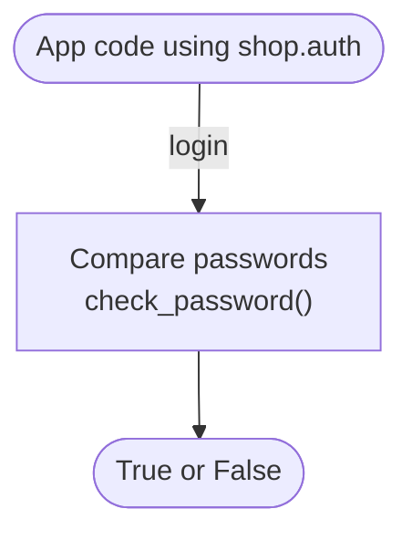
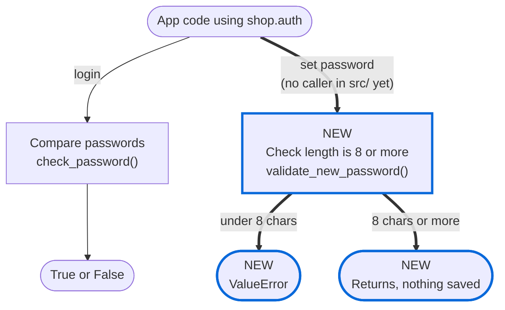

## Explainer

**What changes:** adds a public `validate_new_password()` that rejects new passwords under 8 characters, but nothing in `src/` calls it yet, so no password is checked today.

- New: `validate_new_password` raises `ValueError` below `MIN_PASSWORD_LENGTH = 8` (`src/shop/auth/__init__.py:4`, `src/shop/auth/__init__.py:12-18`).
- Unchanged: `check_password` (`src/shop/auth/__init__.py:7-9`), so existing short passwords still log in (`tests/test_auth.py#test_existing_short_password_still_checks`).
- You decide: is 8 the right minimum, and should this PR also call the check where a password is set (no such code exists in `src/` today)?
- Tier 2: `src/shop/auth/__init__.py` matches the trust boundary `**/auth/**`.

### Before

### After

How to read: NEW / CHANGED / REMOVED name the change · thick blue border = new or changed step · dashed border = removed step · thick arrow = new call · dotted arrow = removed call · plain = unchanged
